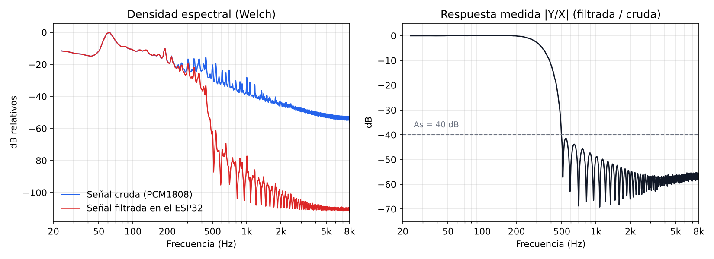

# Agente P — filtrado digital adaptativo sobre ESP32 asistido por IA local

Sistema que captura audio en tiempo real con un ESP32, deja que un agente de inteligencia artificial
**local** elija el filtro adecuado (FIR o IIR) a partir de las especificaciones del usuario, calcula los
coeficientes de forma determinista y los carga en el microcontrolador, que filtra el audio sin interrumpir
la captura. Las señales se envían a MATLAB para el análisis espectral.

Proyecto integrador de **Técnicas Digitales III** (Ingeniería Electrónica, UTN Facultad Regional Paraná,
2026). Docente: Ing. Alejandro Dachary.

> **Alcance de este repositorio.** Contiene el firmware del ESP32, los receptores de MATLAB y una
> sesión de audio registrada. No incluye el código del proxy RAG (servidor Flask, modelos y base de
> conocimiento) ni la versión posterior del firmware con la que se grabó esa sesión; ver
> [Estructura del repositorio](#estructura-del-repositorio).

> **English summary.** Adaptive digital filtering on an ESP32 assisted by a local (on-premise) AI agent.
> The user sets the pass and stop frequencies and whether linear phase is required from a web page served
> by the ESP32. A local LLM with RAG (Ollama, ChromaDB) chooses the filter family, `scipy.signal`
> computes the minimum order and the coefficients, and the ESP32 loads them and filters 16 kHz I2S audio
> in real time (FIR by direct convolution, IIR as cascaded second-order sections, no DSP libraries),
> using FreeRTOS tasks pinned to each core. Audio is streamed over TCP to MATLAB for live FFT analysis.
> This repository holds the ESP32 firmware, the MATLAB receivers and a recorded session; the RAG proxy
> code is not included. Team project, UTN Paraná, 2026.

## Equipo

Matias Vicentin, Ramiro Paul y Leonel Tomasini.

**Mi aporte (Matias Vicentin):** definición de la arquitectura en cinco etapas (adquisición, decisión
del agente, cálculo de coeficientes, filtrado embebido y análisis en MATLAB) y de sus decisiones de
diseño: separar el modelo de lenguaje del cálculo numérico, usar dos modelos según la latencia
requerida y proteger los coeficientes con un mutex no bloqueante para no interrumpir el muestreo.
Integración y depuración del sistema completo, desde Docker y la red hasta el firmware ESP-IDF y las
tareas de FreeRTOS.

## Arquitectura

```
micrófono ─► PCM1808 ─I2S 16 kHz─► ESP32 ──► filtro FIR / IIR ──TCP:3333──► MATLAB (FFT en tiempo real)
                                     ▲  │
              página web (puerto 80) │  │ fp, fr, fase lineal
                                     │  ▼
                       proxy RAG (Flask) ──► LLM local + base de conocimiento ──► scipy.signal
                                     └──────────── coeficientes en JSON ◄──────────────┘
```

1. **Adquisición:** el ADC PCM1808 entrega audio por I2S a 16 kHz. El ESP32 genera MCLK (GPIO0), BCK
   (GPIO26) y LRC (GPIO25) y lee los datos por GPIO35.
2. **Interfaz:** el ESP32 sirve una página web donde se cargan la frecuencia de paso, la de rechazo y si se
   requiere fase lineal. El tipo de respuesta (pasabajos o pasaaltos) se deduce de fp y fr.
3. **Decisión:** un servidor Flask (proxy RAG) consulta a un modelo de lenguaje local (llama3.2:3b,
   temperatura 0) que elige la familia: FIR con ventana Kaiser, IIR Butterworth o IIR Elíptico. Un segundo
   modelo (qwen3:14b) con una base de 74 documentos de DSP indexados en ChromaDB atiende las consultas
   técnicas. Todo corre en la PC del laboratorio con Docker y GPU, sin servicios en la nube.
4. **Cálculo:** el orden mínimo y los coeficientes salen de `scipy.signal` (`kaiserord`, `buttord`,
   `ellipord`) con As = 40 dB y Rp = 1 dB. El modelo de lenguaje decide la estrategia, pero nunca
   calcula coeficientes.
5. **Filtrado embebido:** el ESP32 recibe el JSON, carga los coeficientes y filtra muestra a muestra.

## Firmware (ESP-IDF + FreeRTOS)

- **Núcleo 0, prioridad 10:** tarea de captura I2S por DMA. Aplica el filtro activo y encola cada muestra
  con su número de secuencia.
- **Núcleo 1, prioridad 5:** tarea de transmisión. Envía las muestras a MATLAB por TCP en lotes de 32.
- **FIR:** convolución directa sobre una línea de retardo de hasta 201 coeficientes.
- **IIR:** cascada de hasta 6 secciones de segundo orden en forma directa II, para evitar los problemas
  numéricos de las formas directas de orden alto.
- **Cambio de filtro sin cortes:** un mutex de FreeRTOS protege los coeficientes. La tarea de captura lo
  pide sin esperar; si en ese instante se están cargando coeficientes nuevos, esa muestra pasa sin filtrar
  y el muestreo sigue a ritmo de hardware.
- Implementado sin librerías de DSP. Uso de memoria: 81,1 % de la Flash y 20,7 % de la RAM.

## Resultados

### Decisiones del agente

Con fs = 16 kHz, As = 40 dB y Rp = 1 dB:

| Especificación | Resultado |
|---|---|
| fp = 3000 Hz, fr = 3500 Hz, sin fase lineal | IIR Elíptico de orden 5 (3 secciones), pasabajos |
| fp = 3000 Hz, fr = 3500 Hz, con fase lineal | FIR Kaiser (β = 3,40), orden 72 (73 coeficientes), pasabajos |
| fp = 4000 Hz, fr = 3000 Hz, sin fase lineal | IIR Elíptico de orden 5, pasaaltos (deducido de fp > fr) |
| Orden por encima del límite del ESP32 | Rechazo con HTTP 422 y mensaje explicativo |

Los órdenes y β coinciden con un cálculo independiente con `scipy.signal`.

### Filtrado medido en el ESP32

Sesión real de 105 s registrada con el receptor de MATLAB (señal cruda y filtrada a la vez,
[`datos/sesion_audio_datos.mat`](datos/sesion_audio_datos.mat)). Durante los primeros 66 s no hay filtro
cargado y las dos señales son idénticas. A partir de ahí el ESP32 aplica el filtro elegido:



La respuesta medida es la de un pasabajos con banda de paso hasta unos 250 Hz y más de 40 dB de
atenuación a partir de 500 Hz. Los lóbulos decrecientes en la banda de rechazo son los de un FIR con
ventana. Las especificaciones exactas de esa sesión no quedaron registradas.

En esa sesión se perdió el 15 % de las muestras por desborde de la cola de transmisión del ESP32. Se
detecta por los huecos en el número de secuencia y no altera la medición, porque las muestras perdidas
faltan a la vez en la señal cruda y en la filtrada.

## Estructura del repositorio

```
src/main.cpp                          Firmware del ESP32 (ESP-IDF): I2S, filtros, web, cliente del proxy, TCP
src/config.example.h                  Red WiFi e IP del proxy (copiar como config.h)
matlab/agente_p_recv.m                Receptor TCP con FFT en dB (paquetes de 6 bytes: secuencia + filtrada)
matlab/agente_p_recv_crudo_filtrado.m Receptor con dos paneles, cruda y filtrada (paquetes de 10 bytes)
datos/sesion_audio_datos.mat          Sesión registrada: audio crudo y filtrado, fs, muestras perdidas
docs/respuesta_medida.png             Figura de la sección de resultados
```

El firmware incluido transmite la señal filtrada en paquetes de 6 bytes y se usa con
`agente_p_recv.m`. La versión posterior, que transmite la señal cruda y la filtrada en paquetes de 10
bytes y expone `/filtro_info` (la usada para grabar la sesión de arriba), y el código del proxy RAG no
están incluidos en este repositorio.

## Uso

1. Copiar `src/config.example.h` como `src/config.h` y completar la red WiFi y la IP de la PC del proxy.
2. Compilar y cargar con PlatformIO (`platformio.ini`, ESP-IDF, NodeMCU-32S). El monitor serie muestra la
   IP del ESP32.
3. Con el proxy RAG corriendo en el puerto 8080 de esa PC, abrir la IP del ESP32 en el navegador, cargar
   fp, fr y fase lineal, y consultar al agente.
4. En MATLAB, poner la IP del ESP32 en `agente_p_recv.m` y ejecutarlo. Al cerrar la figura guarda el
   audio en WAV y los datos en MAT.

## Contacto

**Matias Vicentin**, estudiante de Ingeniería Electrónica, UTN Facultad Regional Paraná.
[LinkedIn](https://www.linkedin.com/in/matiasvicentin)
